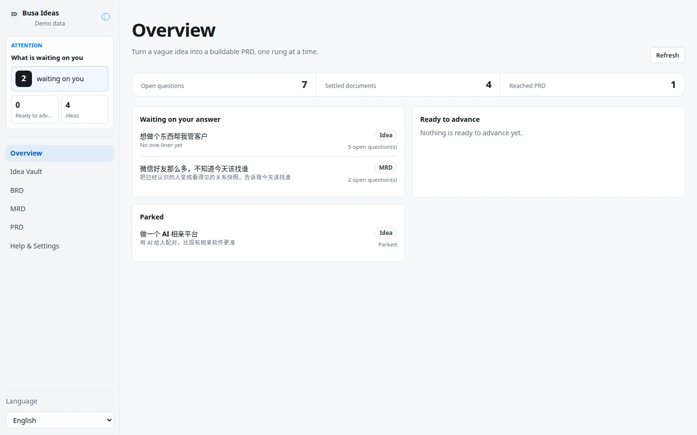
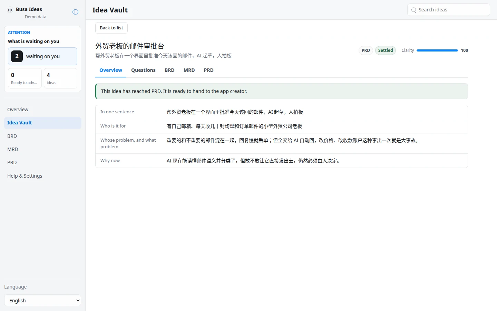
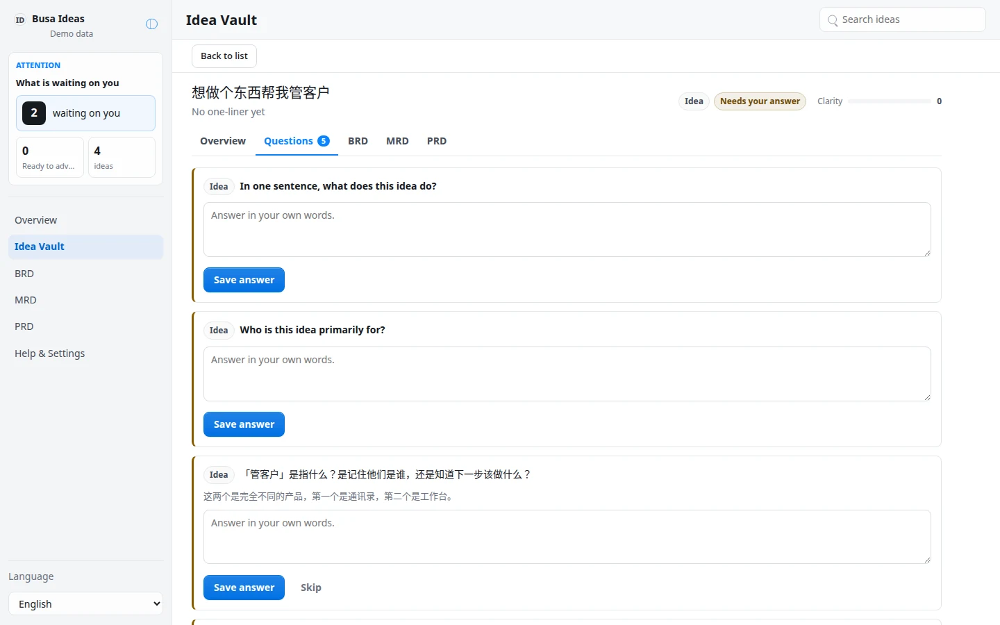
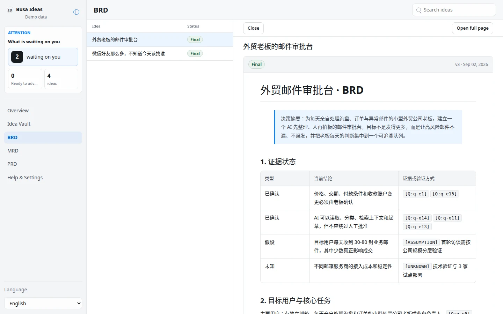

# Busa Ideas

Busa Ideas is a Busabase-backed App-in-Skill idea vault with a business
consultant attached. It interrogates a vague idea until it is sharp, then
carries it through BRD, MRD, and PRD.

## What It Shows

- Idea vault: every idea as one row — what it needs next, its rung, its
  derived clarity score — filterable by what it needs from you.
- Overview: what is waiting on you, what is ready to advance, and what is
  parked, with three totals the sidebar does not already show.
- BRD / MRD / PRD: a reading queue of every idea that has that document, with
  the open document beside it (opening on the idea you last looked at).
- Idea detail: overview (one-liner, who, problem, why-now), the consultant's
  questions and your answers, and the advance gate — blocked with a reason,
  or ready with one click.
- Rich documents: rendered GitHub-flavored Markdown with tables, images,
  strict-mode Mermaid diagrams, and sanitized SVG figures.
- Decision-grade output: a completed BRD, MRD, or PRD includes evidence and
  assumptions, a meaningful diagram, a decision table, risks, and testable
  success or acceptance criteria.
- The gate is the one hard rule: an idea cannot leave a rung while any
  required field is blank or any question on that rung is unanswered, and
  the check is re-derived server-side on every advance, not trusted from
  the UI.

## PRD Review And Handoff

Reaching PRD does not finalize its document. Version 0.2.2 derives document
badges/counts from nonempty canonical content, completed status, and no
blocking gaps. Handoff also checks required information and open questions,
then asks for explicit confirmation; it never starts a build. Read
[the review and upgrade guide](references/document-readiness.md).

## Build A Workspace App From A Reviewed PRD

The public build route uses `busabase` and `busabase-app-creator`, installable in
an Agent environment with:

```bash
npx skills add busabase/skills --skill busabase --skill busabase-app-creator
```

Give the Agent the exact Ideas Space and Idea link. It checks the merged PRD,
shows you which document version it will use, and asks you to confirm the
handoff. The creator then proposes a separate app plan for your approval;
reaching PRD or confirming handoff does not create or publish an app. The
[English/Chinese handoff guide](references/build-handoff.md) includes a copyable
prompt, retry behavior, and how to update an existing Ideas manual.

Template **0.2.3** updates these instructions and the AirApp's Agent prompt.
The AirApp runtime remains **0.2.2**; there is no new build button or runtime
code upgrade in this release.

## App UI Screenshots

<table>
  <tr>
    <td width="50%"></td>
    <td width="50%"></td>
  </tr>
  <tr>
    <td><strong>Overview</strong><br>What is waiting on you, what is ready to advance, and what has been parked.</td>
    <td><strong>Idea detail</strong><br>A finished idea's overview: one-liner, who it's for, the problem, and why now.</td>
  </tr>
  <tr>
    <td width="50%"></td>
    <td width="50%"></td>
  </tr>
  <tr>
    <td><strong>Consultant questions</strong><br>Each question shows why it's being asked, and an answer/skip action.</td>
    <td><strong>BRD / MRD / PRD</strong><br>Every idea's document of one kind as a reading queue beside the open document, with its status, version, and any recorded gaps.</td>
  </tr>
</table>

## Running Locally

```bash
pnpm --dir content/busa-ideas-app install
pnpm --dir content/busa-ideas-app dev
```

Open the printed URL. A standalone local preview asks you to connect
Busabase (Cloud or a custom server) and select a Space — never an API key.

## Demo Mode

Add a demo path to see mock data without a Busabase connection:

```text
/?demo=1&lang=en#/overview
/?demo=needs-answer&lang=en#/ideas/idea-vague/questions
/?demo=ready&lang=en#/ideas/idea-email/prd
/?demo=parked&lang=en#/ideas/idea-parked
```

Demo mode never reads or writes Busabase.

## Data

All persistent data — ideas, documents, questions, and settings — lives in
Busabase Bases under one application Folder. See `SKILL.md` and
`references/ideas-schema.md` for the resource map and record shapes.

## Answer Review And Existing Installations

Saving an answer or skipping a question uses your Busabase permissions. With
write access it saves immediately; otherwise it submits for review, keeps your
submitted answer visible, and links to the Workspace Inbox. Refreshing or
retrying an identical pending answer does not create another review request.
Required-field answers still need both the Question and Idea changes merged.

See [the answer-review guide](references/question-review.md) for the workflow
and how an Agent can update an existing installation without recreating data.
